# Personal Space

**See the whole crowd.** When several players stand on the same tile, Old School RuneScape only
draws one of them, so a packed bank, the Grand Exchange, an anvil or a campfire looks half empty.
Personal Space brings everyone back into view and gives them a little room, so every player and
every outfit can be seen. Often it isn't a big crowd at all: the one player you saw by the fire
turns out to be four friends hanging out.

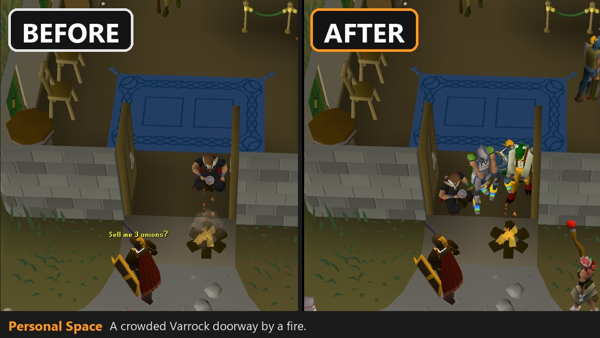

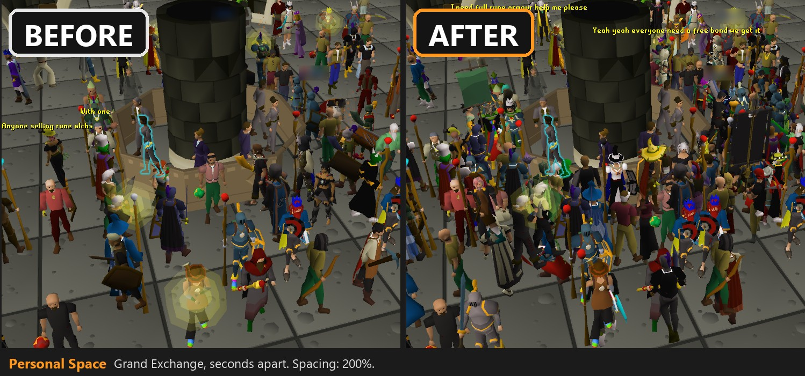

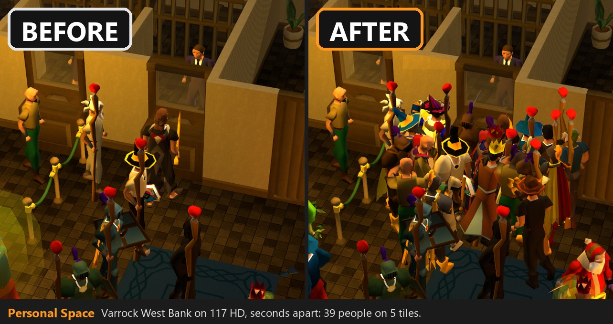

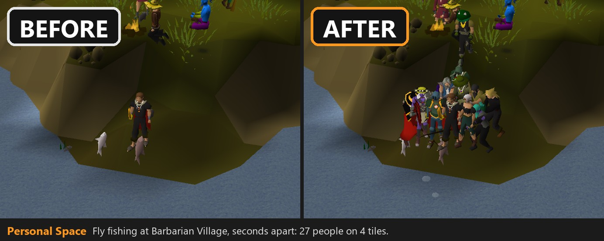

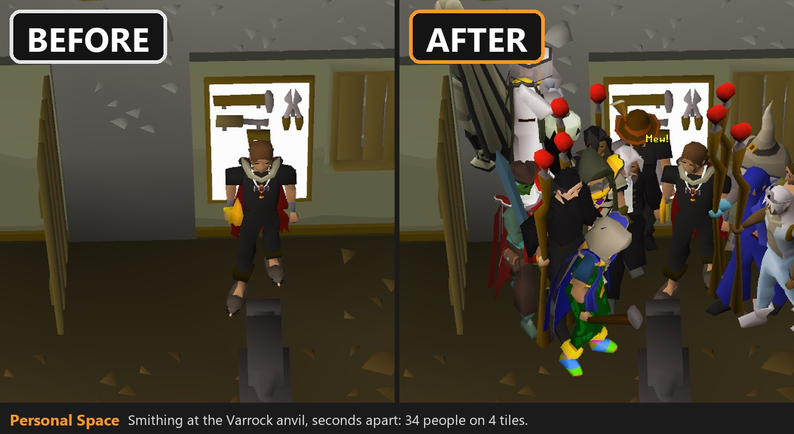

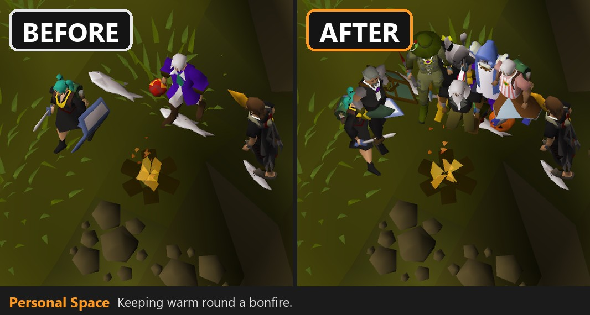

[](https://buy.stripe.com/aFafZg9ehaaxaVaf3e00000)

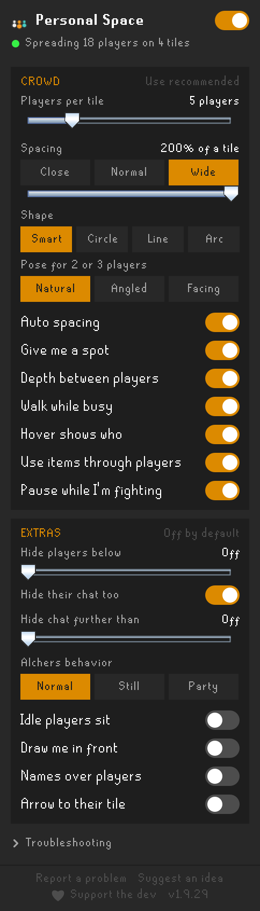

## What it does

- **Shows the players the game hides.** Everyone stacked on a tile is drawn again, spread out around it.
- **Smart layouts.** Rows along bank counters and riverbanks, curves round anvils and fires (never
  standing in them), rings out in the open. Never into walls, booths or water.
- **Drawn the way they really stand.** Each part of each body is hidden only where someone is
  really in front of it, so nothing pops or flickers as you turn the camera.
- **Calm crowds.** People walk into place, keep their spots as others come and go, and
  neighbouring groups never merge into each other.
- **You stay in sight.** Nobody is drawn inside you, and with **Give me a spot** you get the
  front spot at a counter or fishing spot. **Draw me in front** keeps you on top of your crowd.
- **Names and hover.** **Names over players** puts names over the bodies, using your Player
  Indicators settings. Hover anyone to see who they are, with an arrow to where they really stand.
- **Hide the level-3 bots.** An optional combat-level filter, which hides their chat too. Friends,
  friends chat and clan members always stay.
- **Poses for screenshots.** Angle pairs and small groups towards each other, or draw any crowd up
  in a **Line** or an **Arc**.
- **Visual only, and safe.** Clicks, trades and names stay where people really stand. Off in the
  Wilderness, PvP areas and worlds, PvP minigames and while you fight, and it never shows players
  the game or another plugin hides.
- **Boats too.** New and untested (I have no boat): please report anything odd.

### Great for

- **Photos and fashionscape.** Every outfit in a crowd can be seen. Pose pairs and small groups,
  or draw a crowd up in a Line or an Arc, and turn Auto spacing off to spread people out for the shot.
- **Shooting stars.** The team mining a star is a crowd again, not one body.
- **Rock crabs and other shared training spots.** See everyone sharing the spot. Turn off
  **Pause while I'm fighting** to keep the crowd spread out while you train.
- **Banks and the Grand Exchange.** See how busy it really is, and hide the level-3 bots.
- **Skilling with friends.** Fires, anvils, fishing spots and trees, everyone in view.
- **Clan events, drop parties and streams.** A crowd looks as big as it really is.

Needs the **GPU** plugin or **117 HD** (the sidebar has a **Turn on GPU** button). Works alongside **True Tile Movement Animations**.

<br clear="right">

## In game

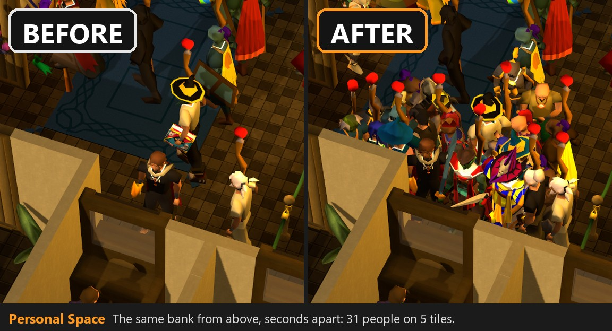

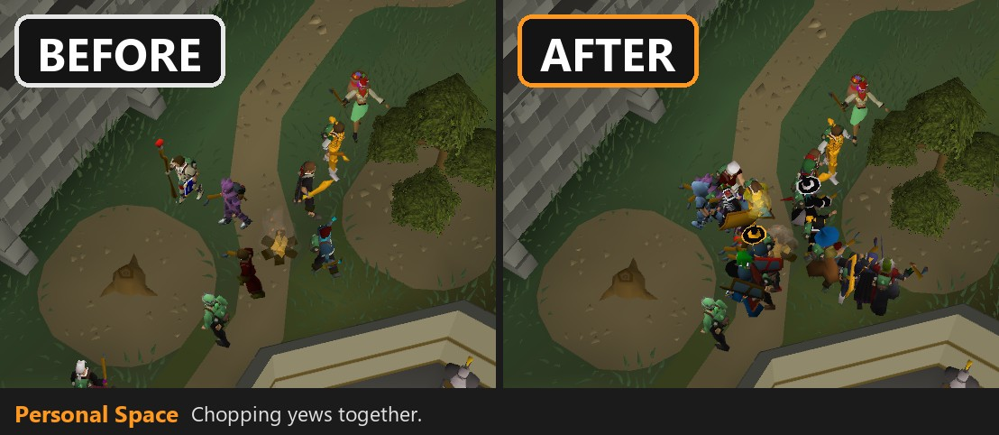

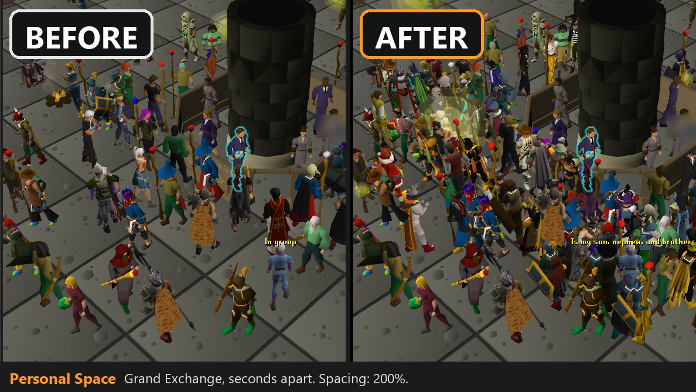

### Who's who

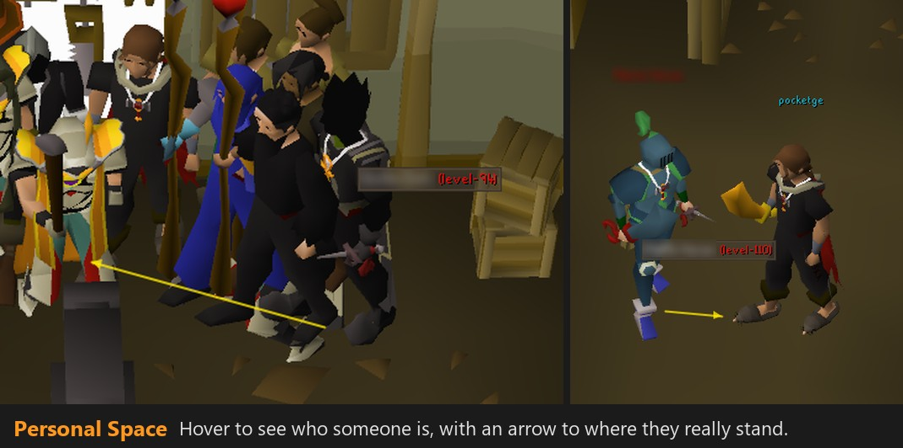

### Posing a pair or a group

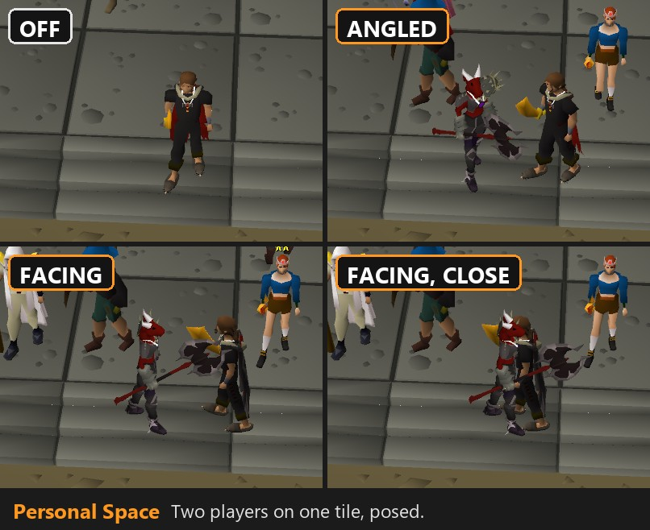

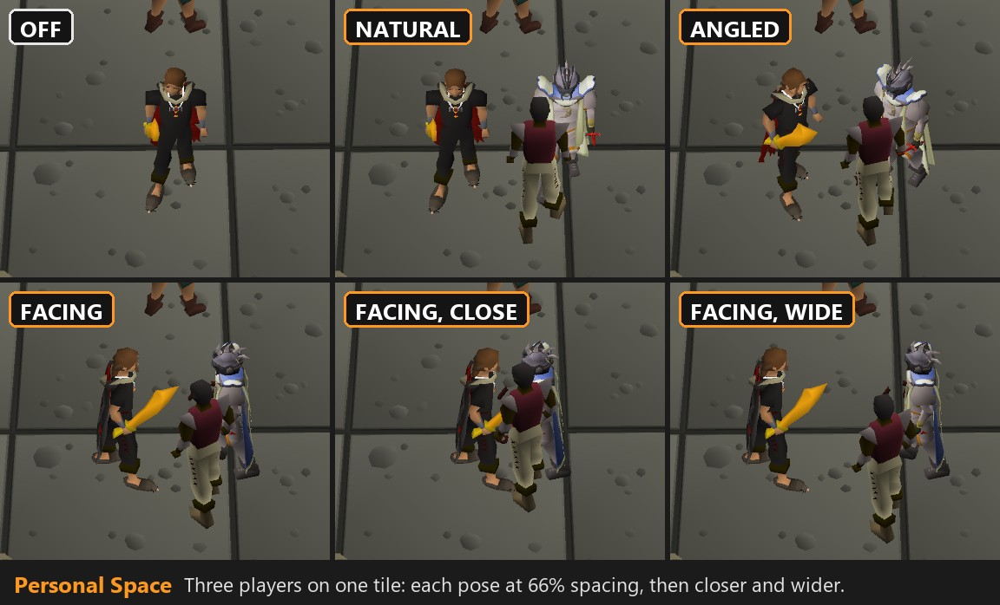

### While you're fighting

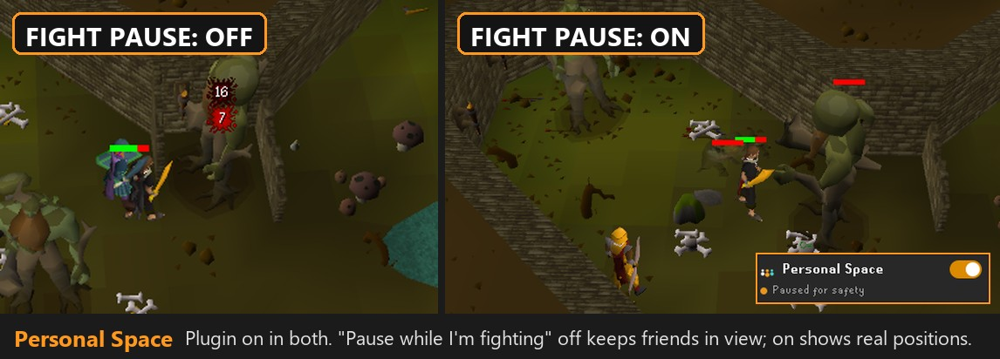

## Using it

Click the **Personal Space** button on RuneLite's right-hand toolbar.

| Setting | What it does |
| --- | --- |
| On/off switch | Spread out crowds, or show the game as normal. The line under it says what's happening right now. |
| Players per tile | How many on one tile get their own spot: 2 to 16, and 5 is the sweet spot. Higher fits more people, packed tighter. |
| Hide chat further than | Off, or a distance in tiles: public chat from anyone further away isn't shown over their head or in the chat box, so a busy bank across the road stays quiet while you smith. Friends, friends chat and clan always show. |
| Idle players sit | Off by default. On: other players who've stood doing nothing for 30 seconds (away from the keyboard) sit down, in the game's Sit emote, and get up the moment they move, talk or do something. Only on your screen. |
| Alchers behavior | **Normal**, **Still** (other players casting High or Low Alchemy, Superheat Item, Charge Orb or an Enchant spell just stand, with no spell effect) or **Party** (each cast becomes a dance, jig, spin, cheer, jump for joy or the Party emote with its glowing floor, at random). Only how they look to you; your own spells never change. |
| Hide players below | Off, or a combat level: anyone below it is hidden, like Entity Hider. **Hide their chat too** drops their chat as well. Friends, friends chat and clan always stay. |
| Spacing | Close, Normal or Wide (the default), or drag the slider. **Use recommended** puts the crowd settings back to the defaults. |
| Shape | **Smart** picks one for the place: rows at banks and counters, one crowd round an anvil or fire, a ring in the open. **Circle**, **Line** and **Arc** use that shape everywhere. |
| Pose for 2 or 3 players | **Natural**, **Angled** (half turned towards each other) or **Facing** each other. |
| Auto spacing | On: the gaps suit the place, staying close at banks, counters, walls and fires and for small groups. Off: the Spacing slider sets every gap, handy for photos. |
| Names over players | Names over the bodies instead of the pile, with your Player Indicators settings. Turn off Player Indicators' name position, or you'll see two. |
| Hover shows who | Hover someone drawn away from their tile to see their name and level. |
| Arrow to their tile | Off by default. On: hovering someone who's been moved also shows an arrow to where they really stand. |
| Use items through players | Using an item or spell on what you see (a fire, a booth), people drawn away from their tile or hidden in a crowd don't take the left-click. Right-click still lists them. |
| Draw me in front | Always draw yourself over the people in your crowd. |
| Depth between players | On (recommended): in a crowd, shields, capes and hats stay properly in front of or behind the people next to them as you turn the camera. Off: everyone is drawn whole, one over another, as the game does, so gear pops between people. GPU plugin only. |
| Walk while busy | Someone busy with something (alching, tending a fire) is shown taking the steps when they're moved to a spot, instead of gliding there. |
| Give me a spot | On (the default): you're spread out too, taking a spot in the crowd (the front one, at a bank counter). Off: you stay exactly where you stand and the crowd spreads around you. |
| Pause while I'm fighting | Shows everyone where they really stand while you fight. Keep it on for raids and bosses; turn it off for training spots like rock crabs. |
| Show sidebar button | Hide the sidebar button; every setting is still in the plugin's configuration. |
| Troubleshooting | Live status and checks, and **Copy report** for bug reports. |

If crowds aren't spreading, open **Troubleshooting**: the status at the top says why (for example
the GPU plugin is off, or you're in a PvP area) and what to do.

## Support the developer

Personal Space is free, and it will stay free. If it made your world feel busier, here's how to
help it keep improving:

- **[Tip the developer](https://buy.stripe.com/aFafZg9ehaaxaVaf3e00000)** through Stripe. Any amount helps.
- **Star this repository** on GitHub so more players find it.
- **Share screenshots** of a busy world with Personal Space on.
- **Report a problem** or **suggest an idea** in [Issues](https://github.com/grant9008/personal-space/issues), or with the links at the bottom of the sidebar.
  Pressing **Copy report** under Troubleshooting and pasting it in helps a lot.

## How it works

The game adds players to the scene every frame, and when several stand still in the exact middle
of one tile it only adds the first. Personal Space sits in front of the GPU renderer
(`DrawCallbacks`): when the game draws that first player, it also draws the others on the tile at
their spots, using each player's own current model, animation and facing.

To make sure it only ever draws players the game is willing to show (and never, say, an invisible
moderator), it watches RuneLite's render callback, which only sees players the game has already
decided to draw. Players stacked behind someone are briefly let through one at a time to be
confirmed; the frame looks identical while this happens.

Everything is public RuneLite API. No reflection, nothing saved about other players, nothing sent
anywhere.

### Known limits

- **Spell and emote graphics** (for example High Alchemy) still appear at the middle of the tile.
- Players busy with an emote or action (sitting, smithing) slide into place instead of walking, so their action isn't interrupted.
- If **Entity Hider** hides every relevant player, the status may wrongly turn red.
- Players past the "players per tile" limit stay hidden in the middle, as in the normal game.
- On a boat, nobody steps out of your view: the deck has coordinates of its own, so the plugin can't tell where the camera is from you.

## Development

- **Run Dev Client.bat**, or in IntelliJ the **Run Dev Client** configuration, starts RuneLite with the plugin loaded.
- **Check Build.bat** compiles and runs the unit tests.
- Java 11. `.github/workflows/build.yml` builds on every push.

```
src/main/java/com/grant9008/personalspace/
  PersonalSpacePlugin.java      plugin entry: safety rules, per-tick layout, sidebar updates
  SpreadingDrawCallbacks.java   sits in front of the renderer; draws players at their spots
  StackProbe.java               confirms players are ones the game is willing to draw
  CrowdPlanner.java             per tick: which tiles are spread and who stands where
  StackSpreader.java            the spots on a tile: rings, curved rows, straight counter rows
  ShapeMemory.java              keeps a tile's row or crowd shape while the same people are there
  SlotBook.java                 keeps everyone's spot as people come and go
  CollisionTerrain.java         where a player can stand, from the game's walkability map
  StackRegistry.java            which players share each crowded tile
  StillnessTracker.java         "is this player standing still"
  OffsetTable.java              current offsets and walking into place
  PersonalSpacePanel.java       the sidebar
  StatusSummary.java, Snapshot.java   status line, live checks and report
  PersonalSpaceConfig.java      settings
```
