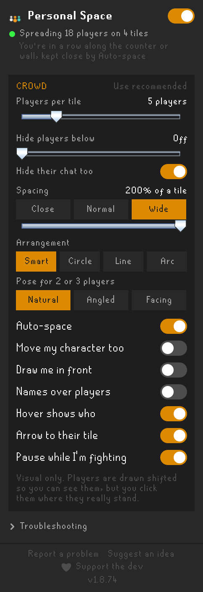
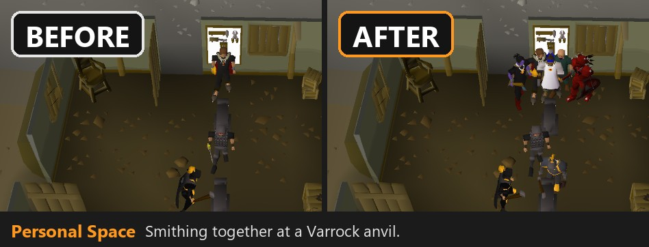
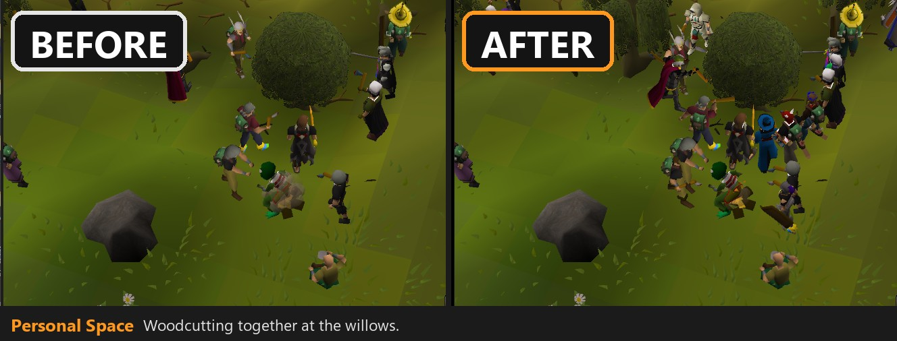

# Personal Space

**See the whole crowd.** When several players stand on the same tile, Old School RuneScape only
draws one of them, so a packed bank, the Grand Exchange, an anvil or a campfire looks half empty.
Personal Space brings everyone back into view and gives them a little room, so every player and
every outfit can be seen. Often it isn't a big crowd at all: the one player you saw by the fire
turns out to be four friends hanging out.


[](https://buy.stripe.com/aFafZg9ehaaxaVaf3e00000)



## What it does

- **Shows the players the game hides.** Everyone stacked on a tile is drawn again, spread out around it.
- **Smart layouts.** Rows along bank counters and riverbanks, curves round anvils and fires (never
  standing in them), rings out in the open. Never into walls, booths or water.
- **Drawn the way they really stand.** Each part of each body is hidden only where someone is
  really in front of it, so nothing pops or flickers as you turn the camera.
- **Calm crowds.** People walk into place, keep their spots as others come and go, and
  neighbouring groups never merge into each other.
- **You stay in sight.** Nobody is drawn inside you, and with **Move my character too** you get the
  front spot at a counter or fishing spot. **Draw me in front** keeps you on top of your crowd.
- **Names and hover.** **Names over players** puts names over the bodies, using your Player
  Indicators settings. Hover anyone to see who they are, with an arrow to where they really stand.
- **Hide the level-3 bots.** An optional combat-level filter, which hides their chat too. Friends,
  friends chat and clan members always stay.
- **Poses for screenshots.** Angle pairs and small groups towards each other, or draw any crowd up
  in a **Line** or an **Arc**.
- **Visual only, and safe.** Clicks, trades and names stay where people really stand. Off in the
  Wilderness, PvP areas and worlds, PvP minigames and while you fight, and it never shows players
  the game or another plugin hides.
- **Boats too.** New and untested (I have no boat): please report anything odd.

Needs the **GPU** plugin or **117 HD** (the sidebar has a **Turn on GPU** button). Works alongside **True Tile Movement Animations**.

<br clear="right">

## In game








### Who's who


### Posing a pair or a group


### While you're fighting


## Using it

Click the **Personal Space** button on RuneLite's right-hand toolbar.

| Setting | What it does |
| --- | --- |
| On/off switch | Spread out crowds, or show the game as normal. The lines under the title say what's happening right now, for example "Spreading 7 players on 3 tiles" and "You're in a row along the counter or wall". |
| Players per tile | How many players on one tile get their own spot: 2 to 16, with 5 as the sweet spot. Raise it if a busy bank booth leaves a heap of people in the middle; the higher it goes, the further out the crowd reaches to make room. |
| Hide players below | Off (the default), or a combat level: anyone below it isn't drawn or clickable, and neither is their overhead chat, health bar or hitsplats, as with Entity Hider. With **Hide their chat too** (on by default) their public chat is dropped from the chat box as well, and stays dropped for the session after they walk out of view. Friends, friends chat and clan members always stay. Off in PvP areas and while you fight. |
| Spacing | Close, Normal (a tile apart) or Wide (two tiles apart, the default), or drag the slider. **Use recommended**, at the top of the Crowd card, puts the crowd settings back to the defaults. With **Auto-space** on, bank counters, walls and fires stay closer on their own; turn it off and the slider sets the distance everywhere. Changes show live. |
| Arrangement | **Smart**: a line along whatever people are facing - a counter, a wall, an anvil, a fire - and a ring out in the open, where there's nothing to line up along. **Circle**: always a ring. **Line**: side by side anywhere, even in the open. **Arc**: a curve, like the crowd round an anvil. |
| Pose for 2 or 3 players | **Natural**: the way they really face. **Angled**: turned halfway towards each other. **Facing**: towards each other. Players at an anvil, booth or fire keep facing it. |
| Auto-space | On: the plugin picks sensible distances whatever the Spacing slider says, so groups of 2 or 3 stay close together and people at a bank counter, a wall or a fire stand shoulder to shoulder. Turn it off to unlock the slider: it then sets how far apart everyone stands, handy for photos, though a tight spot or a big crowd on one tile can still keep people closer. |
| Names over players | Off by default. On: names follow the bodies. Who gets a name, the colours and the rank icons are your **Player Indicators** settings, so change them there; nothing changes but where the names sit. Player Indicators itself can't follow the bodies, so turn off its **Name position** (or the plugin) or you'll see two names per person. |
| Hover shows who | On (the default): hover a body drawn away from its tile and a tooltip says who it is. What a click does is unchanged. |
| Arrow to their tile | On (the default): hover a body drawn away from its tile and a small arrow points to where they really stand. Works with or without the tooltip. |
| Draw me in front | Off (the default): whoever is between you and the camera covers you, as they really would. On: you're drawn over everyone in your crowd, whichever way the camera faces, so you can always see yourself. Either way nobody moves out of your way: crowds huddle as they would, and stand as they are when you walk up beside them. |
| Move my character too | Off: you stay put and others step around you. On: you take a spot too, straight away when you stop rather than off to the side first. At a bank counter or a fishing spot you get a place at the front, even where the bank is so narrow only one or two fit. Nobody is drawn inside you; to always see yourself in a packed bank or anvil pile, turn on **Draw me in front**. Once you've settled you keep your place in your group as people come and go, though the group can widen, tighten or slide over a little to make room for people next to it. |
| Pause while I'm fighting | On (the default): everyone is shown where they really stand while you fight, and for a few seconds after. Keep it on for raids and group bosses, where standing on the same tile matters. Turn it off to keep seeing the crowd during ordinary fights like training or slayer. |
| Show sidebar button | On (the default): Personal Space has a button in the sidebar with its settings and a live status. Off: no button, for a tidy sidebar; every setting is still in the plugin's configuration. |
| Troubleshooting | What Personal Space is doing right now, test mode, **Depth between players** (on; turn off only if you see glitches inside characters), live checks and a **Copy report** button for bug reports. |

If crowds aren't spreading, open **Troubleshooting**: the status at the top says why (for example
the GPU plugin is off, or you're in a PvP area) and what to do.

## Support the developer

Personal Space is free, and it will stay free. If it made your world feel busier, here's how to
help it keep improving:

- **[Tip the developer](https://buy.stripe.com/aFafZg9ehaaxaVaf3e00000)** through Stripe. Any amount helps.
- **Star this repository** on GitHub so more players find it.
- **Share screenshots** of a busy world with Personal Space on.
- **Report a problem** or **suggest an idea** in [Issues](https://github.com/grant9008/personal-space/issues), or with the links at the bottom of the sidebar.
  Pressing **Copy report** under Troubleshooting and pasting it in helps a lot.

## How it works

The game adds players to the scene every frame, and when several stand still in the exact middle
of one tile it only adds the first. Personal Space sits in front of the GPU renderer
(`DrawCallbacks`): when the game draws that first player, it also draws the others on the tile at
their spots, using each player's own current model, animation and facing.

To make sure it only ever draws players the game is willing to show (and never, say, an invisible
moderator), it watches RuneLite's render callback, which only sees players the game has already
decided to draw. Players stacked behind someone are briefly let through one at a time to be
confirmed; the frame looks identical while this happens.

Everything is public RuneLite API. No reflection, nothing saved about other players, nothing sent
anywhere.

### Known limits

- **Spell and emote graphics** (for example High Alchemy) still appear at the middle of the tile.
- Players busy with an emote or action (sitting, smithing) slide into place instead of walking, so their action isn't interrupted.
- If **Entity Hider** hides every relevant player, the status may wrongly turn red.
- Players past the "players per tile" limit stay hidden in the middle, as in the normal game.
- On a boat, nobody steps out of your view: the deck has coordinates of its own, so the plugin can't tell where the camera is from you.

## Development

- **Run Dev Client.bat**, or in IntelliJ the **Run Dev Client** configuration, starts RuneLite with the plugin loaded.
- **Check Build.bat** compiles and runs the unit tests.
- Java 11. `.github/workflows/build.yml` builds on every push.

```
src/main/java/com/grant9008/personalspace/
  PersonalSpacePlugin.java      plugin entry: safety rules, per-tick layout, sidebar updates
  SpreadingDrawCallbacks.java   sits in front of the renderer; draws players at their spots
  StackProbe.java               confirms players are ones the game is willing to draw
  CrowdPlanner.java             per tick: which tiles are spread and who stands where
  StackSpreader.java            the spots on a tile: rings, curved rows, straight counter rows
  ShapeMemory.java              keeps a tile's row or crowd shape while the same people are there
  SlotBook.java                 keeps everyone's spot as people come and go
  CollisionTerrain.java         where a player can stand, from the game's walkability map
  StackRegistry.java            which players share each crowded tile
  StillnessTracker.java         "is this player standing still"
  OffsetTable.java              current offsets and walking into place
  PersonalSpacePanel.java       the sidebar
  StatusSummary.java, Snapshot.java   status line, live checks and report
  PersonalSpaceConfig.java      settings
```
